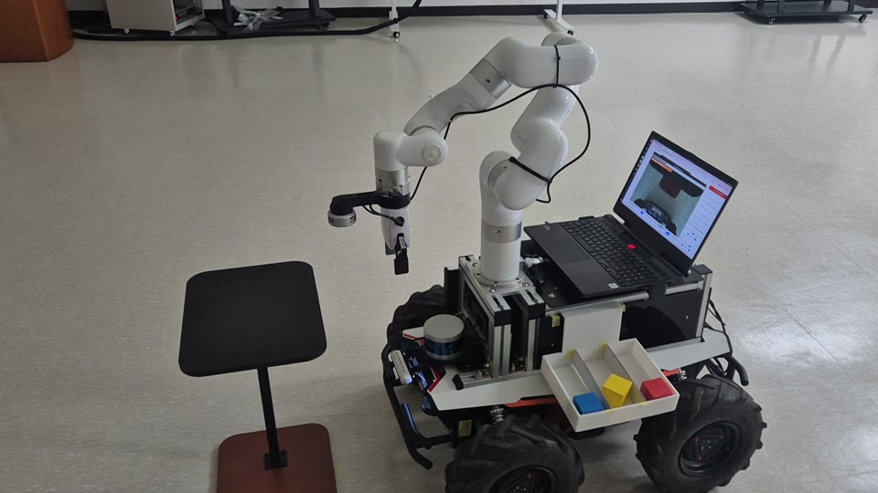
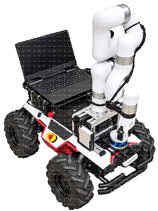
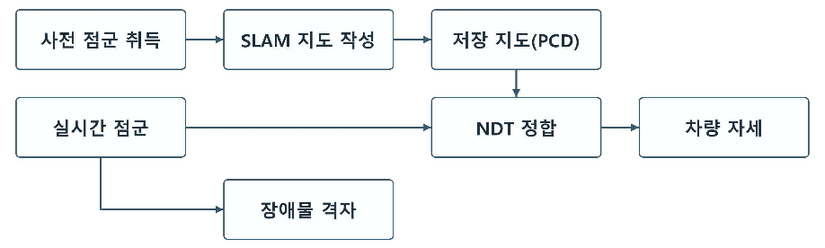
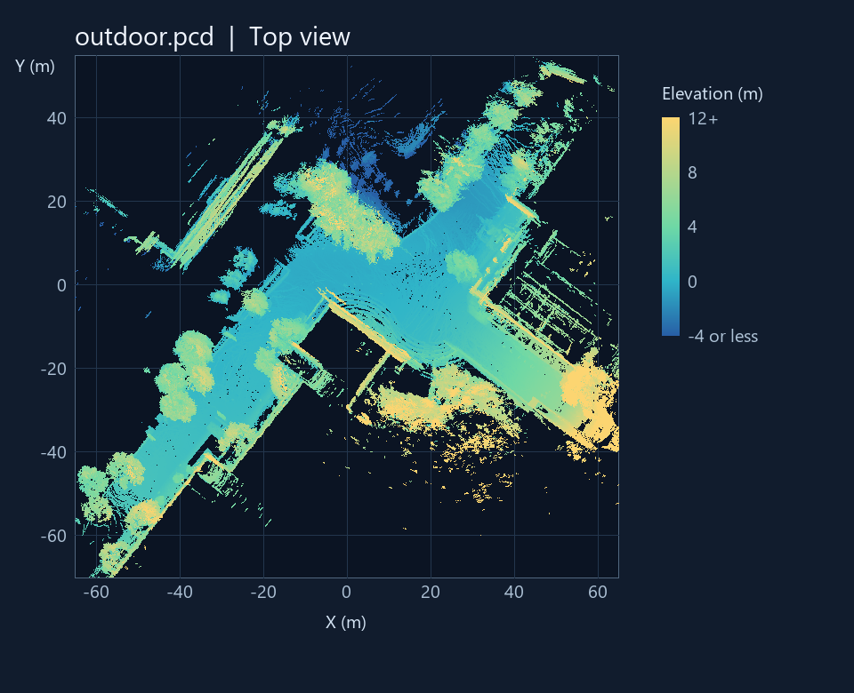
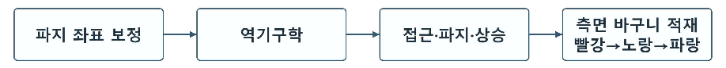

# 모바일 매니퓰레이터 물류 자동화 시스템

**[▶ 실내 통합 시연 보기](https://app.notion.com/p/41c18a17dfa6816c8ad6ec392436eaca#41d18a17dfa6819fbf0eebe2973f869b)** · [시스템 기술 상세](docs/SYSTEM_DESIGN.md) · [통합 시험 문제 해결](docs/INTEGRATION_DEBUGGING.md)

SCOUT 2.0과 xArm5를 결합해 **실내 픽업존까지 이동하고, 작업대의 상자를 인식해 차량 측면 트레이에 순서대로 적재**하는 3인 팀 졸업작품입니다.

## 프로젝트 한눈에 보기

| 항목 | 내용 |
| --- | --- |
| 작업 흐름 | 픽업존 접근 → 정지 → 상자 인식 → 파지·분류 적재 |
| 플랫폼 | SCOUT 2.0, xArm5, Velodyne VLP-16, RealSense L515 |
| 실행 환경 | ROS 1 Noetic · C++ · Python 3 |
| 주요 기술 | HDL Graph SLAM, HDL Localization, DWA, YOLOv8n, RGB-D 좌표 계산 |
| 김재윤 담당 | 3D LiDAR 지도 작성, 위치 추정 설정, DWA 주행 수정, 전체 통합 테스트 |

## 실내 통합 시연

<table>
<tr>
<td width="50%"></td>
<td width="50%"></td>
</tr>
<tr>
<td align="center">픽업존에서 상자 파지</td>
<td align="center">차량 측면 트레이에 3색 상자 적재 완료</td>
</tr>
</table>

실내 시연에서 차량이 픽업존에 접근해 정지한 뒤, 팔이 **빨강 → 노랑 → 파랑** 상자를 순서대로 집어 트레이에 적재하는 것을 확인했습니다.

## 시스템 구성

<table>
<tr>
<td width="70%"></td>
<td width="30%"></td>
</tr>
<tr>
<td align="center">주행·인지·조작 구성도</td>
<td align="center">SCOUT 2.0과 xArm5 통합 장비</td>
</tr>
</table>

### 1. 지도 작성과 위치 추정



HDL Graph SLAM으로 3D 점군 지도를 저장합니다. 주행할 때는 HDL Localization이 실시간 LiDAR 점군을 저장 지도에 NDT 정합해 차량 자세를 추정합니다. 주행 장애물 격자는 실시간 점군으로 생성합니다.

<table>
<tr>
<td width="50%"><a href="media/indoor-map-m304.png"></a></td>
<td width="50%"><a href="media/outdoor-map.png"></a></td>
</tr>
<tr>
<td align="center">실내 지도 · <a href="maps/m304.pcd">m304.pcd</a></td>
<td align="center">야외 지도 · <a href="maps/outdoor.pcd">outdoor.pcd</a></td>
</tr>
</table>

각 지도의 주요 구간을 위에서 본 모습입니다. 색은 높이를 나타내며, 가로·세로 축과 높이 범례의 범위는 지도마다 다릅니다. 아래 실행 예시는 실내 지도 `m304.pcd`를 사용합니다.

### 2. DWA 접근 주행과 단계 전환


RViz에서 초기 자세와 픽업존 목표를 지정합니다. DWA는 차량 자세와 장애물 정보를 받아 속도 후보별 궤적을 평가합니다. 현재 실내 설정의 DWA 도착 허용 거리는 **0.3 m**이며, 목표점 주변 **0.75 m**의 점은 DWA 장애물 입력에서 제외하도록 설정했습니다. [주행 설정 YAML](local_ws/src/scout_dwa/config/dwa_scout_low_speed_test.yaml)

통합 시험에서는 DWA와 안전을 위한 별도 확인 단계의 완료 판정 기준이 달라, DWA가 완료 신호를 보내도 파지로 넘어가지 않는 문제가 있었습니다. 현재 코드는 DWA의 완료 신호를 전환 기준으로 삼고, 차량을 정지시켜 주행 프로그램이 정상 종료된 뒤 인식·파지 프로그램을 실행합니다. [단계 전환 코드](run_dwa_then_xarm.py)

### 3. RGB-D 상자 인식과 순차 적재


팔 말단에 장착한 L515의 RGB 영상에서 YOLOv8n으로 상자를 검출하고, 깊이 정보를 사용해 상자의 3차원 위치를 계산합니다.


검출 화면에는 색상별 경계 상자와 깊이 정보가 표시됩니다.



로봇팔은 보정한 목표 좌표로 접근해 상자를 집어 올린 뒤 색상에 해당하는 트레이 위치에 내려놓습니다.

## 실행

ROS 1 Noetic과 Scout·Velodyne·HDL Localization·RealSense·xArm 드라이버, MoveIt이 준비된 Linux 환경이 필요합니다. 의존성 버전은 [dependencies.repos](dependencies.repos), 패키지별 출처는 [THIRD_PARTY.md](docs/THIRD_PARTY.md)를 참고하세요.

저장소 루트에서 차량·센서 환경을 준비합니다.

```bash
bash start_all.sh --map-pcd "$PWD/maps/m304.pcd"
```

RViz의 **2D Pose Estimate**로 초기 위치와 방향을 입력한 뒤, 같은 저장소의 별도 터미널에서 실행합니다.

```bash
source local_ws/devel/setup.bash
python3 run_dwa_then_xarm.py --run --map-pcd "$PWD/maps/m304.pcd"
```

목표 대기 메시지가 표시되면 RViz의 **2D Nav Goal**로 픽업존을 지정합니다. 기반 워크스페이스의 설치 위치가 기본 경로와 다르면 `SCOUT_BASE_SETUP`에 해당 환경의 `devel/setup.bash`를 지정합니다.

## 저장소 구성

| 경로 | 역할 |
| --- | --- |
| [local_ws/src/scout_dwa](local_ws/src/scout_dwa) | 센서·지도 연동, 주행 연결, 명령 감시 |
| [local_ws/src/dwa_planner](local_ws/src/dwa_planner) | DWA 주행 후보 생성과 평가 |
| [local_ws/src/use_yolo](local_ws/src/use_yolo) | YOLOv8n 검출, xArm5 파지·적재 제어 |
| [launch/system.launch](launch/system.launch) | 차량·센서·ROS 환경 준비 |
| [run_dwa_then_xarm.py](run_dwa_then_xarm.py) | 주행에서 인식·파지 단계로 전환 |
| [media](media) | 통합 구성도, 실내 시연 장면, 지도와 상자 검출 화면 |
