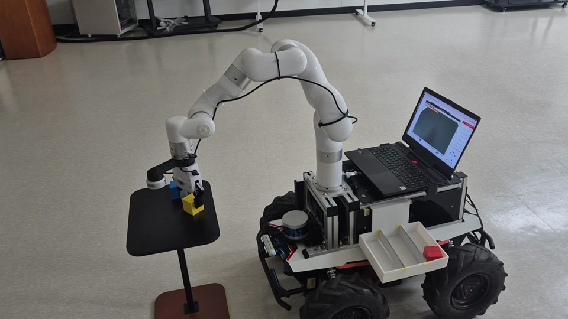
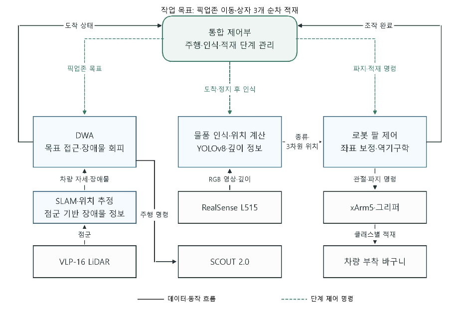
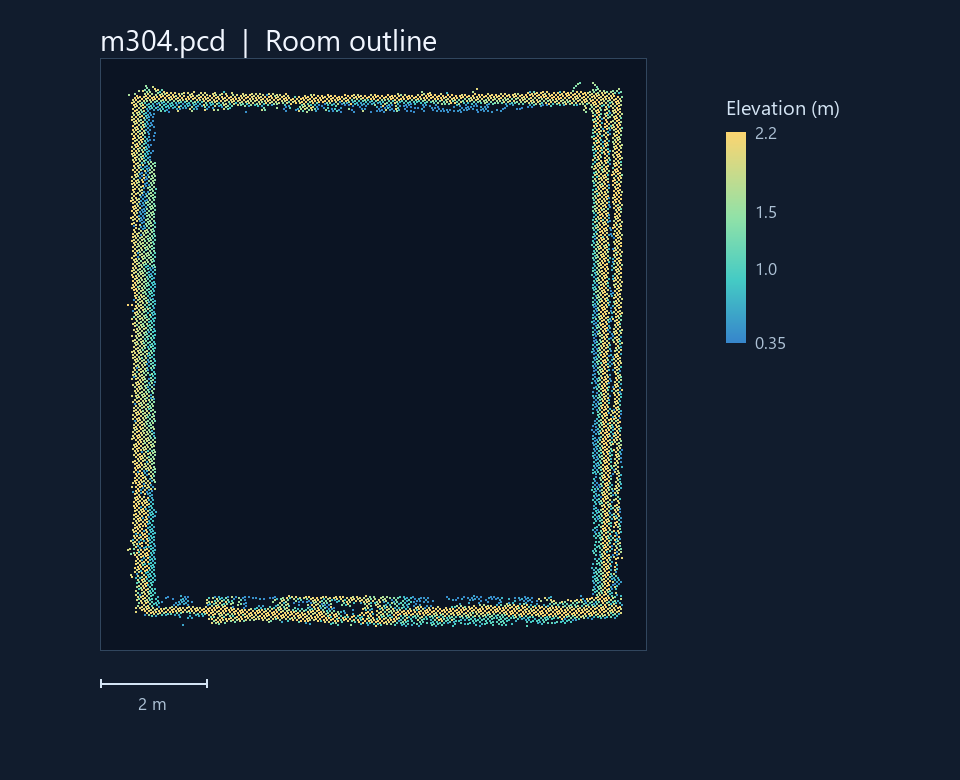

# 모바일 매니퓰레이터 물류 자동화 시스템

[▶ 실내 통합 시연 보기](https://youtu.be/7SqIaekgKKs) · [기술 상세](docs/SYSTEM_DESIGN.md) · [통합 시험 문제 해결](docs/INTEGRATION_DEBUGGING.md)

SCOUT 2.0이 실내 픽업존에 도착하면 xArm5가 상자를 인식하고, 빨강·노랑·파랑 상자를 차례로 집어 차량 측면 트레이에 싣는 3인 팀 졸업작품입니다.

| 항목 | 내용 |
| --- | --- |
| 성과 | 제35회 순천향대학교 공과대학 학술제 은상 |
| 장비 | SCOUT 2.0, xArm5, Velodyne VLP-16, RealSense L515 |
| 환경 | ROS 1 Noetic, C++17, Python 3 |
| 김재윤 담당 | 3D LiDAR 지도 작성, HDL Localization 설정, DWA 수정, 실차 통합 시험 |
| 팀원 담당 | xArm5 조작부 |

## 시연 결과

<table>
<tr>
<td width="50%"></td>
<td width="50%"></td>
</tr>
<tr><td align="center">픽업존에서 상자 파지</td><td align="center">상자 세 개 적재 완료</td></tr>
</table>

픽업존 접근과 정지부터 상자 세 개의 순차 적재까지 실내에서 확인했습니다.

## 시스템 구조



1. **지도와 위치 추정** — HDL Graph SLAM으로 PCD 지도를 만들고, HDL Localization이 실시간 LiDAR 점군을 저장 지도에 NDT 정합합니다.
2. **주행과 정차** — RViz에서 픽업존을 지정하면 DWA가 실시간 장애물 격자를 바탕으로 접근합니다. 주행 완료 후 차량을 정지시키고 DWA를 종료하면 YOLO·xArm 단계가 시작됩니다.
3. **인식과 적재** — 팔 끝의 RealSense L515에서 얻은 RGB-D 영상으로 상자 위치를 계산하고, xArm5가 색상별 트레이 위치에 상자를 옮깁니다.

[통합 장비 사진](media/hardware-assembly.png) · [RGB-D 검출 화면](media/detection-latest.png)

### LiDAR 점군 지도

<table>
<tr>
<td width="50%"><a href="media/indoor-map-m304.png"></a></td>
<td width="50%"><a href="media/outdoor-map.png"></a></td>
</tr>
<tr>
<td align="center">실내 지도 · <a href="maps/m304.pcd">m304.pcd</a></td>
<td align="center">야외 지도 · <a href="maps/outdoor.pcd">outdoor.pcd</a></td>
</tr>
</table>

위 점군에서 색은 높이를 나타냅니다. 아래 통합 실행과 시연은 실내 지도 `m304.pcd`를 사용합니다.

## 빌드 및 실행

ROS Noetic과 Scout·Velodyne·HDL Localization·RealSense·xArm 드라이버, MoveIt을 준비합니다. 외부 의존성 버전과 기반 워크스페이스 설정은 [설치 안내](docs/DEPENDENCIES.md)를 참고하세요.

저장소 루트에서 차량과 센서 환경을 준비합니다. 기본 기반 워크스페이스 경로가 다르면 `SCOUT_BASE_SETUP`으로 해당 환경의 `devel/setup.bash`를 지정합니다.

```bash
bash start_all.sh --map-pcd "$PWD/maps/m304.pcd"
```

RViz의 **2D Pose Estimate**로 초기 위치와 방향을 지정한 뒤, 저장소 루트의 별도 터미널에서 주행·파지 실행기를 시작합니다.

```bash
source local_ws/devel/setup.bash
python3 run_dwa_then_xarm.py --run --map-pcd "$PWD/maps/m304.pcd"
```

목표 대기 메시지가 나오면 RViz의 **2D Nav Goal**로 픽업존을 지정합니다. 이 명령은 실제 장비를 구동하므로 주변 공간과 비상정지 장치를 먼저 확인하세요.

## 저장소 구성

| 경로 | 내용 |
| --- | --- |
| [`launch/system.launch`](launch/system.launch) | 차량, LiDAR, 위치 추정, 카메라, xArm 실행 |
| [`launch/mapping.launch`](launch/mapping.launch) | HDL Graph SLAM 지도 작성용 설정 |
| [`local_ws/src/scout_dwa`](local_ws/src/scout_dwa) | 점군 입력, 목표 주행, 차량 명령 감시 |
| [`local_ws/src/dwa_planner`](local_ws/src/dwa_planner) | DWA 속도 후보 생성과 궤적 평가 |
| [`local_ws/src/use_yolo`](local_ws/src/use_yolo) | 상자 검출 모델, RGB-D 위치 계산, 파지·적재 |
| [`run_dwa_then_xarm.py`](run_dwa_then_xarm.py) | 주행 종료 후 인식·파지 단계 실행 |
| [`dependencies.repos`](dependencies.repos) | 외부 ROS 패키지의 버전 고정 목록 |

외부 코드와 모델·지도 출처는 [출처 및 라이선스](docs/THIRD_PARTY.md)에 정리했습니다.
