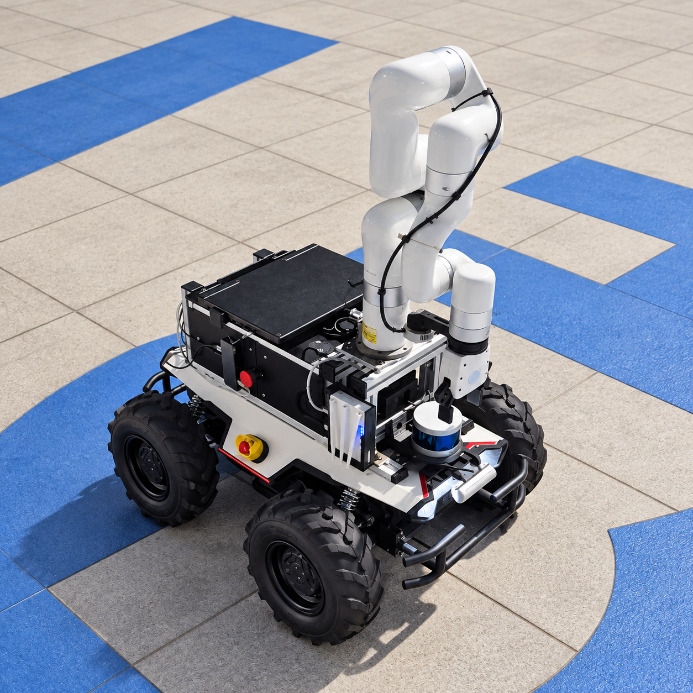
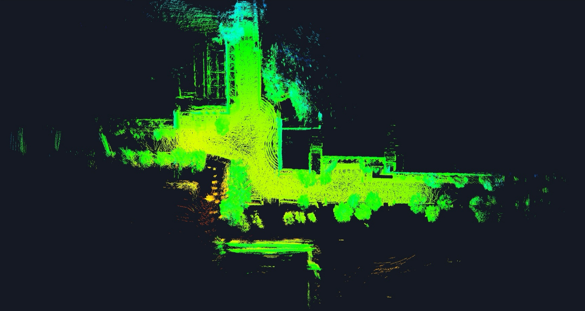
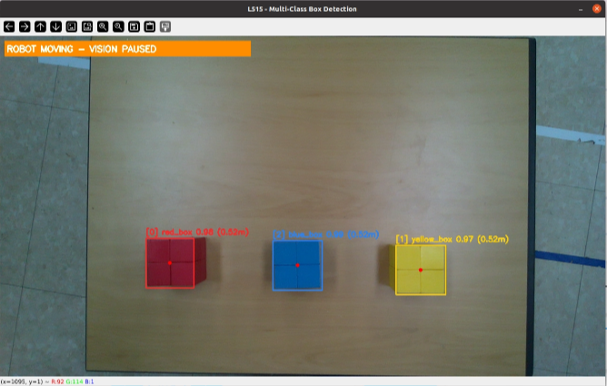
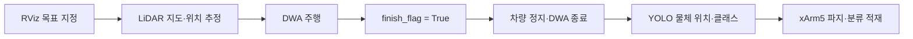

# Scout DWA + xArm5 Vision Pick & Place

**3D LiDAR 지도 기반 자율주행과 비전 물품 분류를 통합한 졸업작품**입니다. HDL Graph SLAM으로 작성한 지도에서 로봇 위치를 추정하고, DWA로 작업 위치까지 이동한 뒤 YOLO 검출 결과를 이용해 xArm5로 물품을 파지·분류합니다.

| 항목 | 내용 |
|---|---|
| 기간 | 2026년 5월~10월 |
| 팀 구성 | 3인 |
| 김재윤 담당 | 지도 작성, localization 적용·설정, DWA 수정, 전체 통합 테스트 |
| 팀원 역할 | xArm 관련 작업 1인, 프로젝트 보조 1인 |

SLAM·위치 추정·DWA의 기존 패키지를 활용하고 프로젝트 장비에 맞게 구성·수정·통합했습니다. 세부 수정 내용과 문제 해결 경험은 확인된 내용을 기준으로 추가합니다.



## 시연과 결과

[야외 통합 시연 영상](https://github.com/kjy-02/scout-dwa-xarm-pick-place/releases/tag/demo-v1) · [통합 문제와 해결](docs/INTEGRATION_DEBUGGING.md)

야외에서 목표 위치까지 주행한 뒤 차량을 정지하고, 작업대의 물체를 검출해 파지·분류하는 통합 시연을 진행했습니다. L515 카메라의 미사용 pointcloud 기능을 비활성화해 통합 실행 중 카메라 미송출 문제를 해결했습니다. 충전기 분리 시 나타난 간헐적인 프레임 저하는 절전 모드 전환에 따른 현상으로 추정합니다.

| 지도 작성 결과 | 최신 객체 검출 화면 |
|---|---|
|  |  |

지도 작성과 위치 추정의 자료, 야외 시연 기록은 [프로젝트 자료 정리](docs/PROJECT_OVERVIEW.md)에 기록했습니다. 도착 후 단계 전환과 카메라 입력 수신 문제는 [통합 문제와 대응](docs/INTEGRATION_DEBUGGING.md)에 정리했습니다.

ROS 1 Noetic 환경에서 Scout의 목표 주행과 xArm5의 비전 기반 물품 분류·이동을 연결한 프로젝트입니다.

RViz에서 목표를 지정하면 DWA로 주행하고, DWA가 완료 신호를 보내면 차량을 정지시키고 주행 프로그램을 종료합니다. 이어 YOLO와 xArm 파지 launch를 실행합니다.



## 구성

| 경로 | 역할 |
|---|---|
| `local_ws/src/scout_dwa` | 차량·LiDAR·지도 연결, 목표 주행, watchdog, 설정 |
| `local_ws/src/dwa_planner` | 수정된 AMSL DWA 계산 코드 |
| `local_ws/src/use_yolo` | 최신 xArm 파지 코드, YOLO 검출 코드, ONNX 모델 |
| `launch/system.launch` | 전체 준비 환경 |
| `start_all.sh`, `start_all.py` | 빌드·환경 적용·준비 환경 실행 |
| `run_dwa_then_xarm.py` | DWA 종료 후 비전·파지 launch 순차 실행 |
| `maps/` | 야외·3층·하드실 PCD 지도 |
| `dependencies.repos`, `docs/` | 외부 의존성 커밋, 로컬 변경, 설치 환경 기록 |
| `third_party/hdl/` | 실제 사용 환경에서 가져온 HDL 패키지 소스·설정 스냅샷 |
| `media/` | 장비·지도·검출 결과 이미지 |

이 폴더 전체가 GitHub 저장소의 루트입니다. `build`, `devel`, ROS bag, 과거 zip, 백업과 에이전트 설정은 배포본에서 제외했습니다.

## 환경

- ROS 1 Noetic, Python 3, catkin
- Scout, SocketCAN `can0` / 500000 bps
- Velodyne LiDAR, HDL localization
- xArm5, MoveIt, xArm gripper
- RealSense RGB·깊이 영상, OpenCV DNN, NumPy, cv_bridge

세 개의 프로젝트 패키지만으로 외부 드라이버까지 설치되는 구조는 아닙니다. **Scout·LiDAR·위치 추정·xArm·RealSense 의존성이 설치되고 빌드된 기반 workspace가 필요합니다.** 상세 목록과 새 PC 구성 시 참고 사항은 [DEPENDENCIES.md](docs/DEPENDENCIES.md)를 확인하세요.

## 기존 PC에서 실행

아래는 저장소를 `~/scout_dwa_xarm`으로 옮겼을 때의 예입니다. 다른 위치에서는 해당 경로를 바꾸세요.

### 1. 준비 환경 — 첫 번째 터미널

```bash
cd ~/scout_dwa_xarm
bash start_all.sh
```

기본 기반 환경은 `~/catkin_ws/devel/setup.bash`입니다. 다른 workspace라면:

```bash
SCOUT_BASE_SETUP=~/robot_dependencies/devel/setup.bash bash start_all.sh
```

스크립트는 이 저장소의 `local_ws`를 증분 빌드하고, CAN·차량·LiDAR·지도·RViz·카메라·xArm 드라이버·MoveIt을 실행합니다. 기존 개별 launch와 이전 주행·파지 실행은 종료한 상태에서 시작하세요. 카메라는 노트북 USB 3 포트에 직접 연결한 구성을 사용했습니다.

RViz에서 `Fixed Frame=map`을 확인하고 `2D Pose Estimate`로 실제 위치·방향을 지정합니다. 지도와 LiDAR 정합을 확인한 뒤 준비 터미널을 유지합니다.

### 2. 최종 주행·파지 — 두 번째 터미널

```bash
cd ~/scout_dwa_xarm
source local_ws/devel/setup.bash
set -o pipefail
python3 run_dwa_then_xarm.py --run --max-seconds 1800 --goal-wait-seconds 1800 2>&1 | tee /tmp/scout_dwa_xarm.log
```

목표 대기 로그가 나온 뒤 RViz의 `2D Nav Goal`로 목적지를 지정합니다. 준비 프로그램은 최종 주행·파지를 자동 실행하지 않습니다. 수동 중단은 실행 터미널의 `Ctrl+C`입니다.

## 지도와 장비 설정

기본 지도는 이 저장소의 `maps/outdoor.pcd`입니다. 다른 지도는 **준비와 주행 명령 양쪽에서 같은 경로**를 지정하세요.

```bash
# 첫 번째 터미널: 3층 지도 준비
cd ~/scout_dwa_xarm
bash start_all.sh --map-pcd "$PWD/maps/floor3.pcd"
```

```bash
# 두 번째 터미널: 동일 지도 확인 경로 지정
cd ~/scout_dwa_xarm
source local_ws/devel/setup.bash
set -o pipefail
python3 run_dwa_then_xarm.py --run --map-pcd "$PWD/maps/floor3.pcd" --max-seconds 1800 --goal-wait-seconds 1800 2>&1 | tee /tmp/scout_dwa_xarm.log
```

하드실은 `maps/hard.pcd`를 사용합니다. xArm 기본 IP는 `192.168.1.210`이며 준비 명령의 `--robot-ip`로 변경합니다. LiDAR IP·센서 TF·관절 자세·파지 오프셋은 현재 실험 장비의 값이므로 장비가 바뀌면 각 launch와 `RobotConfig`를 확인해야 합니다.

## 현재 동작 설정

- DWA 최소 속도 설정: `0.1 m/s`. 출발 시 가속도 제한을 지키도록 최소 후보가 최대 후보를 넘지 않게 보정했습니다.
- 목표 속도 설정: `0.55 m/s`. 실제 주행 속도를 보장하는 값은 아닙니다.
- DWA 도착 허용 거리: `0.5m`.
- 주행 완료는 DWA `finish_flag=True`로 결정합니다. 별도 거리·방향·TF 완료 재검증은 제거했습니다.
- 외부 `cmd_vel_guard`는 현재 목표 주행 launch에서 실행하지 않습니다. DWA 자체 충돌 검사, 명령·차량 상태 검사, 독립 watchdog은 유지합니다.
- 카메라 해상도·fps는 드라이버 자동 선택이며 RealSense pointcloud 필터는 꺼져 있습니다. DWA의 LiDAR pointcloud와 카메라 깊이 영상은 사용합니다.
- YOLO 화면 표시는 기본 활성화, OpenCV 스레드는 기본값, 반복 주기는 최대 30Hz입니다. 실제 추론 속도는 PC에 따라 다릅니다.
- 최신 모델 클래스: `red_box`, `yellow_box`, `blue_box`.
- 최신 xArm 코드는 초기 자세에서 비전을 활성화하고 검출·파지·적재를 반복합니다. 미검출 대기 설정은 `NO_DETECTION_TIMEOUT=5.0`초입니다. 구체적 관절값·순서는 현재 소스를 기준으로 합니다.

## 로그와 확인

```bash
timeout 10 rostopic hz /camera/color/image_raw
timeout 10 rostopic hz /camera/depth/image_rect_raw
timeout 8 rosrun tf tf_echo camera_link ap_target
```

- 환경 로그: `/tmp/scout_system.log`
- 주행·파지 로그: `/tmp/scout_dwa_xarm.log`
- DWA 개별 로그: `/tmp/scout_goal_planner_*.log`

RGB가 끊기면 YOLO는 물체 좌표를 만들 수 없습니다. 카메라 TF가 존재하는 것만으로 영상 정상 수신을 판단하지 않습니다.

## 검증 범위

사용자는 기존 작업 공간에서 통합 정상 동작을 확인했습니다. 이 배포본은 최신 실행용 복사본에서 만들었으며, 경로 이동을 위한 변경과 오프라인 검증 내역은 [EXPORT_NOTES.md](docs/EXPORT_NOTES.md)에 기록합니다. 새 PC의 드라이버 설치와 배포본 전체 실차 운용은 별도 확인이 필요합니다.

## 출처

DWA는 [AMSL dwa_planner](https://github.com/amslabtech/dwa_planner)에서 파생됐습니다. 기존 BSD 라이선스 파일을 유지했습니다. 다른 패키지의 라이선스 선언과 모델 관련 기록은 [THIRD_PARTY.md](docs/THIRD_PARTY.md)를 확인하세요.

HDL Graph SLAM·localization의 사용 환경 소스와 설정은 [HDL 패키지 스냅샷 안내](third_party/hdl/README.md)를 참고하세요. YOLO 학습 자료는 추후 추가할 예정이며 현재 실행용 ONNX 모델은 포함했습니다.
