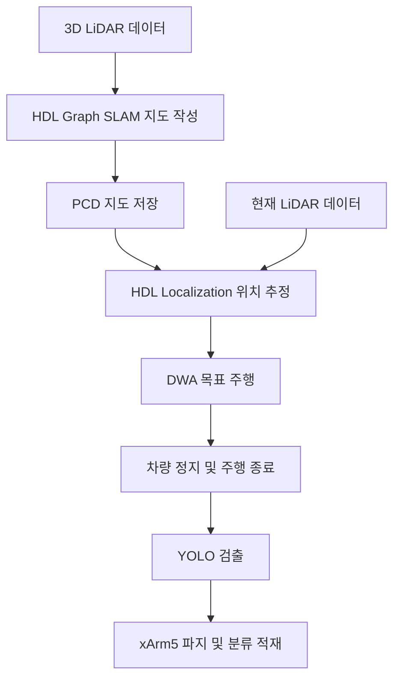

# 프로젝트 구성 및 자료 정리

## 목표와 개인 역할

2026년 5월부터 10월까지 3인 팀으로 진행한 졸업작품이다. 지도 기반 목표 주행과 비전 기반 물품 파지·분류를 순차적으로 연결한다.

- 김재윤: 지도 작성, localization, DWA 수정, 전체 통합 테스트.
- 팀원 1인: xArm 관련 작업.
- 팀원 1인: 프로젝트 보조.

YOLO 학습·데이터 준비 담당은 아직 확인하지 않았다. 코드에 포함됐다는 이유만으로 개인 기여로 배정하지 않는다.

## 지도 작성과 운용의 구분

지도 작성은 사전 단계다. 통합 운용 실행은 저장한 PCD 지도를 불러와 위치 추정과 주행을 수행한다. 이동 중 팔 조작을 동시에 수행한다고 표현하지 않는다.

## 추가 HDL 자료 확인 — 2026-10-29

| 패키지 | ZIP 안의 HEAD | 확인한 자료 |
|---|---|---|
| hdl_graph_slam | 95b8dce41c10667dcf0e3e9801dc22754b3bd525 | 기본·400·501 등 지도 작성 launch, 소스, RViz 설정 |
| hdl_localization | de2dc7769aa2412876d05ae6161408d3295b6a3c | NDT_OMP 위치 추정, 지도 경로, 초기 자세 및 IMU 설정 |
| hdl_global_localization | a6a6b69929ac371d9531d0dcdef3c1593fd49245 | BBS/FPFH 관련 구성, 기본 BBS 설정 |

HEAD는 패키지 내 Git 메타데이터 기준이다. 로컬 변경이 포함될 수 있으므로 해당 커밋만 내려받으면 모든 설정이 같다고 가정하지 않는다.

기본 지도 작성 launch에서 FAST_GICP, voxel grid, loop closure 관련 설정을 확인했다. 실험 장소별 launch가 여러 개 있으므로 실제 사용한 파일과 수정 이유는 추가 확인한다.

추가 HDL ZIP의 독립 localization launch 기본 지도는 hard.pcd이다. 이 통합본의 기본 outdoor.pcd 설정과 구분해야 한다. 통합 실행에는 루트 README와 scout_dwa의 지도 launch를 기준으로 한다.

추가 ZIP은 원본 자료로 보존하고, Git 내부 디렉터리를 제외한 패키지 소스·설정은 `third_party/hdl`에 포함했다. 출처와 기준 커밋은 해당 폴더의 README에 기록했다.

## 시연 자료

- 원본 파일: `1000055311.mp4`, 약 4분 21초, 야외 촬영.
- 사용자 확인: 실제 주행부터 파지·분류까지의 통합 시연.
- 이번 검토: 8개 시점의 프레임을 추출해 야외 로봇 이동 구간과 작업대 앞 팔 동작·물체 파지 장면을 확인했다.
- 전체 프레임의 연속성, 수동 개입 여부, 성공률 및 반복성은 이 표본 확인만으로 판단하지 않는다.
- 원본은 별도 로컬 영상 폴더에 보존한다. 용량을 줄인 공유용 영상은 저장소의 demo-v1 릴리스에 연결한다.

## 버전 기준

현재 최신 코드의 red_box / yellow_box / blue_box를 기준으로 설명한다. original_box / yellow_box / black_box가 적힌 별도 이미지는 최신 모델 결과로 사용하지 않는다. YOLO 학습 자료는 추후 추가 예정이다.

## 후속 정리

지도·DWA 자체에 별도 문제가 있었다고 가정하지 않는다. 사용자가 제공한 10월 7일 작업 로그를 바탕으로 [통합 문제와 대응](INTEGRATION_DEBUGGING.md)을 정리했다. 주요 사례는 도착 후 단계 전환과 카메라 RGB 수신 문제이며, 최소 속도 설정에 따른 후보 범위 보정은 별도 기술 항목이다. 측정하지 않은 성공률이나 오차 개선값은 추가하지 않는다.
